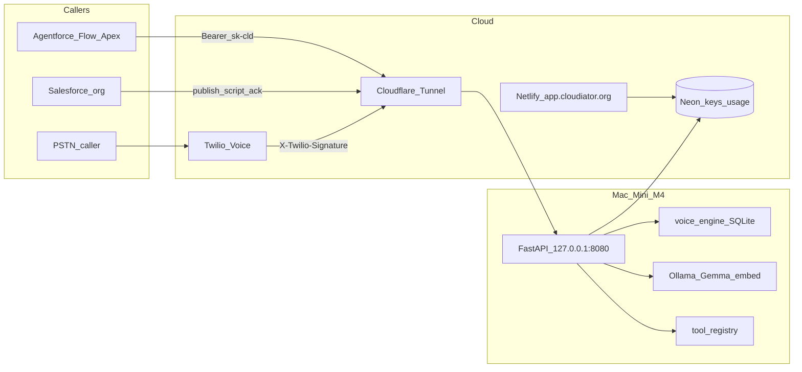

# Claude Code handoff — scripted phone into Salesforce

**Audience:** Claude Code (Opus) implementing the next product slice, not Cursor phases A–F.  
**Repo:** https://github.com/AshrafRezk/cldM4.git  
**Appliance:** Apple Mac Mini M4, 24GB (`api.cloudiator.org`)  
**Budget:** **120 minutes maximum**, then stop. Green pytest beats unfinished Apex.  
**This document is the brief.** Read [PLAN.md](../PLAN.md), [docs/salesforce.md](salesforce.md), [docs/next-steps.md](next-steps.md), and [packages/schema/scopes.json](../packages/schema/scopes.json). Do not invent a second architecture.

---

## 0. What you are building (one sentence)

The Mini answers a Twilio phone number using a **deterministic script published from Salesforce**, hears the caller (Twilio speech), and returns a **CRM commit document** (Lead / Case / Task / …) that Apex inserts and acknowledges — without loading Gemma or Whisper on the live call path.

---

## 1. Business — what Cloudiator is

### Product thesis

Cloudiator is a **private Agentforce appliance**, not a ChatGPT clone and not Einstein GPT.

- Each Salesforce org (or website) gets an OpenAI-compatible **API link**: base URL `https://api.cloudiator.org` + a scoped key `sk-cld-...`.
- Each key is a **contract**: which models, which tools, rate limits, max tokens, whether streaming is forced off (Salesforce preset).
- The public URL returns a **filtered OpenAPI** contract. `?target=salesforce` emits OpenAPI **3.0.3** with **zero** `oneOf` / `anyOf` / `allOf` so External Services can import it.
- A Mac Mini M4 **orchestrates**: deterministic libraries when possible; local models when language / vision / generation is required.
- 24GB means **one Metal-heavy generative model at a time**. Chat stays hot (`gemma4:e4b-it-qat`); exclusive work (FLUX, optional Whisper later) unloads chat first.
- Default languages: **Arabic (MSA) and English**. Image *understanding* is Gemma vision or Apple OCR; image *generation* is FLUX (jobs), never Gemma.

### Why a customer pays

Agentforce can already call Cloudiator for chat, OCR, maps, charts, DuckDB, docs, and FLUX jobs. The **phone line still needs a human**. The product gap is a scripted voice front door on the **same** Mini, configured from the **same** Salesforce org, writing the **same** CRM objects the business already uses.

Value props to keep in every design choice:

1. **Prompts stay off a vendor GPU** for chat/tools. Voice STT in *this* slice uses Twilio’s speech result so the live path never touches Metal (see §3).
2. **Scoped keys** — a support line key can do voice + chat; it cannot mint FLUX or DuckDB unless scoped.
3. **Salesforce-native** — Named Credential, External Credential principal, permission set, `setTimeout(120000)`, `stream: false`. Admins edit scripts in the org, not over SSH.
4. **Libraries first** — a phone script is a state machine, not an 8-iteration tool loop.

### Control plane vs inference plane



- **Netlify** (`https://app.cloudiator.org`): dashboard only. Mint keys, usage, OAS download. **No inference.** Cloudflare Access; no shared password.
- **Neon**: tenants, `api_keys`, `usage_events` / `usage_daily`. Dashboard can mint while the Mini reboots.
- **Tunnel**: `api.cloudiator.org` → `cloudflared` → FastAPI `:8080` only. Port `11434` must never appear in tunnel ingress.
- **Worker**: FastAPI is the only authenticator for `sk-cld-` keys. Cloudflare does TLS / DDoS / WAF skip for Apex — never key validation.

### Worked example (not a hardcoded vertical)

Arabic inbound intake for a sales or clinic desk:

1. Caller dials the Twilio number.
2. Mini speaks (Twilio `<Say>`): greeting in Arabic.
3. Gather name → reason for calling → confirm callback number.
4. Session status → `ready_to_commit` with a Lead (`LastName`, `Company` or placeholder, `Description` / custom fields) plus a Task whose `Description` is the full transcript and whose `WhoId` / related fields are filled after Apex insert order.
5. Apex invocable (or Flow) inserts the sObjects and `POST`s `/v1/voice/sessions/{id}/ack` with the new record Ids.
6. A clinic, real-estate desk, or L1 support line changes **objects and prompts in Salesforce** and republishes. Nobody SSHes the Mini to change the script.

---

## 2. What is already done (do not rebuild)

Live URLs: **API** `https://api.cloudiator.org`, **dashboard** `https://app.cloudiator.org`. Operator status: [next-steps.md](next-steps.md). Console how-to: [using-console.md](using-console.md).

| Phase | Status | What exists |
| --- | --- | --- |
| A | Proven on Mini | FastAPI + uv + Python 3.11 arm64; `/v1/health`, `/v1/chat/completions`, `/v1/embeddings`, `/v1/models`; `metal_lock`; context guard; SSRF on vision URLs; explicit `keep_alive`; LaunchAgent `uvicorn --workers 1` |
| B | Proven | Neon keys (argon2id), 60s key cache, usage outbox, named tunnel `cloudiator-mini`, Salesforce OAS 3.0.3, admin JWT on `/v1/admin*` via Cloudflare Access |
| C | Live | Netlify Vite dashboard; `/console` mint keys / usage / OAS / Apex snippet; no Neon URL in `dist/` |
| D | Proven | Tool registry, OCR (Apple Vision), geocode/places/route, artifact HMAC signing |
| D2 | Proven | Charts, stats, DuckDB sandbox |
| D3 | Proven | Image ops, docs, diagrams (Graphviz default), SF 15/18 Ids, text utilities |
| E | Proven | FLUX 4-bit jobs, exclusive teardown + watchdog, `Idempotency-Key`, SQLite job queue |
| F (worker) | Code done | `force_no_stream` downgrade header; `max_response_bytes` → artifact + preview. **Still open:** real External Services import + Apex callout in a customer org |

**Not built (this handoff):** any telephony, `voice` capability, Twilio webhooks, voice SQLite, Salesforce voice metadata, live Whisper `/v1/audio/transcriptions` (optional in Phase F docs; **do not** pull Whisper for this slice).

Note: [future-phases.md](future-phases.md) mentioned a SIM / Android “Phase G” idea and later H/J (voice console, CRM write-back). **This handoff supersedes that for the first shippable phone product:** Twilio + Salesforce-authored scripts + CRM commit payload. Do not build an Android bridge in this window.

---

## 3. Locked decisions for this slice

| Decision | Choice | Why |
| --- | --- | --- |
| Carrier | **Twilio Programmable Voice** | `<Say>` + `<Gather input="speech">`; TwiML in &lt;2s; no Metal |
| STT on live call | **Twilio speech result** (`SpeechResult`, `language` from script e.g. `ar-EG`, `en-US`) | Whisper large-v3-turbo is an **exclusive** Metal slot in PLAN.md — loading it per utterance would unload Gemma and break chat latency |
| Gemma on call path | **Forbidden** | Deterministic script only; no tool loop; no 8-iteration chat |
| Script authorship | **Salesforce** custom object + publish Apex | Configurable from the org; Mini stores last published JSON |
| Mini store | **SQLite** `VOICE_DB` default `~/Cloudiator/voice.db` | Answer calls if Neon / org blips; Neon is **not** on the webhook path |
| CRM write | Mini renders **commit document**; **Apex inserts** | Same Named Credential pattern as chat; JWT write-from-Mini is a follow-up behind the same payload |
| Twilio auth | `X-Twilio-Signature` + `TWILIO_AUTH_TOKEN` in `~/Cloudiator/.env` | Never put `sk-cld-` in the webhook URL |
| Salesforce auth | Existing Bearer `sk-cld-` + new capability **`voice`** | Same auth stack as `/v1/chat/completions` |
| Idempotency | `CallSid` + step `key` | Twilio retries must not double-append answers |
| Transcripts | Treat like prompts | Do not log when key has `log_prompts=false`; TTL **7 days** after ack (or unacked abandon) |
| OAS | Voice **Salesforce** routes in 3.0.3 filter; **Twilio routes excluded** from `?target=salesforce` | Apex never calls TwiML endpoints |

---

## 4. API contract

### 4.1 Salesforce-facing (Bearer + `voice`)

All JSON. OpenAI-style errors. `X-Request-Id` on every response. Include these in OpenAPI fragments and in `?target=salesforce` (still **no** composition keywords).

#### `POST /v1/voice/scripts`

Upsert the active script for the key’s tenant (or for a named script id if body includes `id`).

```json
{
  "id": "intake-ar",
  "display_name": "Arabic inbound intake",
  "language": "ar-EG",
  "voice": "Polly.Zeina",
  "inbound_numbers": ["+2010xxxxxxx"],
  "steps": [
    {
      "key": "greeting",
      "say": "مرحباً بك في كلاودياتور. سيتم تسجيل هذه المكالمة.",
      "gather": false,
      "next": "ask_name"
    },
    {
      "key": "ask_name",
      "say": "من فضلك قل اسمك الكامل بعد الصافرة.",
      "gather": true,
      "timeout": 5,
      "speech_timeout": "auto",
      "max_attempts": 2,
      "on_fail": "continue",
      "next": "ask_reason"
    },
    {
      "key": "ask_reason",
      "say": "ما سبب اتصالك اليوم؟",
      "gather": true,
      "max_attempts": 2,
      "on_fail": "continue",
      "next": "ask_phone"
    },
    {
      "key": "ask_phone",
      "say": "أكد رقم هاتفك للتواصل.",
      "gather": true,
      "max_attempts": 2,
      "on_fail": "continue",
      "next": "goodbye"
    },
    {
      "key": "goodbye",
      "say": "شكراً لك. سيتم تسجيل طلبك الآن.",
      "gather": false,
      "next": null
    }
  ],
  "commit": {
    "records": [
      {
        "sobject": "Lead",
        "fields": {
          "LastName": "{{ask_name}}",
          "Company": "Phone Intake",
          "Phone": "{{ask_phone}}",
          "Description": "{{ask_reason}}\n\n---\n{{transcript}}"
        }
      },
      {
        "sobject": "Task",
        "fields": {
          "Subject": "Inbound voice intake",
          "Status": "Completed",
          "Description": "{{transcript}}",
          "WhoId": "{{Lead.Id}}"
        },
        "after": ["Lead"]
      }
    ]
  }
}
```

Template rules for `crm.py`:

- `{{step_key}}` → that step’s gathered text (trimmed), or empty string.
- `{{transcript}}` → ordered plain-text transcript of all say/gather turns.
- `{{Lead.Id}}` (and any `{{SObject.Id}}`) → placeholder string left for Apex to resolve **after** parent insert; the commit document must list `after` dependencies so Apex inserts in order. The Mini does **not** call Salesforce in this slice.

Response: `{ "id", "version", "updated_at" }`.

#### `GET /v1/voice/scripts`

List scripts for this tenant (id, display_name, inbound_numbers, updated_at, active).

#### `GET /v1/voice/sessions` / `GET /v1/voice/sessions/{id}`

Tenant-scoped only. Session body includes:

```json
{
  "id": "uuid",
  "call_sid": "CAxxxx",
  "from": "+20...",
  "to": "+20...",
  "script_id": "intake-ar",
  "status": "in_progress|ready_to_commit|committed|abandoned",
  "answers": { "ask_name": "...", "ask_reason": "...", "ask_phone": "..." },
  "transcript": "...",
  "recording_url": "https://api.twilio.com/...",
  "commit": { "records": [ ] },
  "committed_ids": null
}
```

When the script finishes, engine renders `commit.records` with substitutions (except `{{SObject.Id}}` placeholders) and sets `status` to `ready_to_commit`.

#### `POST /v1/voice/sessions/{id}/ack`

```json
{ "record_ids": { "Lead": "00Q...", "Task": "00T..." } }
```

Sets `status` to `committed`, stores `committed_ids`, starts TTL clock for deletion/reduction.

#### Outbound stub (document only or 501)

`POST /v1/voice/calls` may return `501` with a short JSON error pointing at a later campaign phase. Do not implement dial in this window beyond that stub.

### 4.2 Twilio-facing (signature, no Bearer)

`application/x-www-form-urlencoded`. **Not** in `?target=salesforce` OpenAPI.

| Route | Role |
| --- | --- |
| `POST /v1/voice/twilio/inbound` | New call: match `To` → script `inbound_numbers`; create session; return TwiML |
| `POST /v1/voice/twilio/gather` | Step result: `SpeechResult` / empty; advance or replay; return TwiML |
| `POST /v1/voice/twilio/recording` (optional) | Store `RecordingUrl` on session; return empty `<Response/>` |

Invalid / missing signature → **403**, empty body or OpenAI-shaped JSON — **never** TwiML that continues the script.

Idempotency: if the same `CallSid` + step `key` gather is posted twice, return the **same** next TwiML and do not append a second answer.

### 4.3 Capability + env

- Add `"voice"` to `packages/schema/scopes.json` `capabilities`.
- Add `"voice"` to preset `salesforce_engineer` (and optionally a new `voice_intake` preset: `chat`, `voice` only).
- Regenerate / update OpenAPI fragments so Salesforce OAS stays composition-keyword-free.
- Env (document in `docs/voice.md` and `.env.example` comments only; **never commit secrets**):

```bash
TWILIO_AUTH_TOKEN=          # required for signature checks
VOICE_DB=~/Cloudiator/voice.db
VOICE_SESSION_TTL_DAYS=7
PUBLIC_BASE_URL=https://api.cloudiator.org   # already exists; used to build absolute action URLs in TwiML
```

---

## 5. Code layout Claude Code must create

```
apps/worker/app/voice/
  __init__.py
  engine.py       # step machine: start, on_gather, render next action
  twiml.py        # Say / Gather / Hangup / Record callbacks; escape XML
  store.py        # SQLite scripts, sessions, answers; CallSid idempotency
  crm.py          # template render only; no network
  twilio_sig.py   # validate X-Twilio-Signature
  routes.py       # FastAPI routes; wire from main.py the same way tool_routes are mounted
apps/worker/tests/
  test_voice_engine.py
  test_voice_crm.py
  test_voice_twilio_sig.py
  test_voice_routes.py      # inbound→gather→ready_to_commit; tenant isolation; OAS composition count
salesforce/voice/
  objects/Cloudiator_Voice_Script__c.object-meta.md   # or equivalent metadata source
  classes/CloudiatorVoicePublish.cls(+meta)
  classes/CloudiatorVoiceCommit.cls(+meta)
  README.md       # deploy notes: Named Credential, permission set, FLS permission
docs/voice.md     # operator runbook + Arabic example JSON
```

Wire routes in `apps/worker/app/main.py` (or the existing register helper pattern used by `tool_routes.py`). Do **not** scaffold `apps/gateway/`. Do **not** touch Netlify inference. Do **not** change `OLLAMA_MAX_LOADED_MODELS` or add a second uvicorn worker.

### Engine behaviour

1. `on_inbound(To, From, CallSid)` → load active script for `To` → create session `in_progress` → return TwiML for first step (enable call recording callback if script says so; default **on**).
2. `on_gather(CallSid, SpeechResult, step key)` → if empty and attempts &lt; `max_attempts`, replay say/gather; if `on_fail=continue`, store raw/empty and advance; if `on_fail=hangup`, polite say + hangup → `abandoned`.
3. When `next` is null after a non-gather say, render commit via `crm.py`, set `ready_to_commit`, hangup.
4. Never call Ollama, mflux, or Whisper from these modules.

### Salesforce metadata (`salesforce/voice/`)

Custom object `Cloudiator_Voice_Script__c`:

- `Definition__c` — Long Text Area — full script JSON
- `Inbound_Numbers__c` — Text — comma-separated E.164
- `Active__c` — Checkbox
- `External_Id__c` — Text (unique external id matching script `id`)

Invocable Apex (both `setTimeout(120000)`, Named Credential `callout:Cloudiator/...`):

1. **Publish** — POST body from `Definition__c` to `/v1/voice/scripts`.
2. **Commit** — poll or query `ready_to_commit` sessions (or accept session Id input); `JSON.deserialize` commit records; dynamic `sObject` DML **only** for sObject API names present in that script’s `commit.records`; then POST ack.

Hard rules from [salesforce.md](salesforce.md): permission set on External Credential **principal**; never hardcode the key; store artifact / session ids not short-lived signed URLs; do not loop 50 callouts in one transaction.

---

## 6. 120-minute execution plan (stop rules)

Paste this into Claude Code as the working order:

```
You are implementing Cloudiator voice from docs/claude-code-handoff.md only.
Do not start Phase D/E/F work. Do not pull models. Do not load Gemma/Whisper on the call path.
Definition of done = green hermetic pytest + OAS composition check. Live Twilio/org optional.

Minute 0–15:  read PLAN.md §1–4, salesforce.md, scopes.json, main.py tool_routes mount pattern.
Minute 15–50: store.py + engine.py + twiml.py + crm.py + twilio_sig.py + unit tests.
Minute 50–90: routes.py, wire main, scopes voice capability, OpenAPI fragments, route tests
              (signed inbound+gather fixture → ready_to_commit Lead fields).
Minute 90–110: salesforce/voice Apex + object source; docs/voice.md operator steps.
Minute 110–120: full apps/worker pytest -q; jq OAS checks; commit.

STOP RULES:
- At minute 90, if Apex is unfinished: finish pytest green, list missing Apex methods
  as a short checklist at the bottom of docs/voice.md, and stop.
- Do not start Phase D tool work "to fill time."
- Do not download mlx-whisper or FLUX weights.
- Do not commit secrets or ~/Cloudiator/.env.
```

---

## 7. Proof commands (definition of done)

From `apps/worker` with the existing venv (hermetic: **no** network, **no** Ollama required for voice tests):

```bash
cd apps/worker && .venv/bin/pytest -q
# must include new voice tests; entire suite still green
```

Behavioural fixtures (in tests, not manual):

1. Publish script JSON (Arabic intake example) via the scripts route with a key that has `voice`.
2. Build a valid Twilio signature for `POST /v1/voice/twilio/inbound` with `To` matching the script; response TwiML contains `<Say>` and `<Gather>`.
3. Gather posts for each step → session `ready_to_commit`; `commit.records[0].fields.LastName` equals gathered name.
4. Bad signature → 403.
5. Session from tenant A is 404/403 for tenant B’s key.
6. Salesforce OAS:

```bash
# against a running worker OR via the same generator the tests use
jq '.openapi' /tmp/oas.json                                    # "3.0.3"
jq '[.. | objects | select(has("oneOf") or has("anyOf") or has("allOf"))] | length' /tmp/oas.json
# must be 0
```

`ollama ps` is **not** part of this slice’s proof.

---

## 8. Explicit non-goals (this window)

- Phases D / D2 / D3 / E / F rework in [cursor-phases.md](cursor-phases.md)
- `mlx-whisper`, `/v1/audio/transcriptions`, Gemma on the webhook
- Real outbound dial / campaigns (`POST /v1/voice/calls` beyond 501 stub)
- Mini-side Salesforce JWT / Composite API write
- Dashboard UI for scripts (future voice console)
- Downloading Twilio audio onto the Mini disk
- Android / USB SIM bridge
- Video, Docker inference, `uvicorn --workers` ≠ 1, `OLLAMA_MAX_LOADED_MODELS` ≠ 2
- Scaffolding `apps/gateway/`
- Committing `.env` or Twilio tokens

---

## 9. Operator notes after Claude Code lands (human)

1. Buy/configure a Twilio number; voice webhook `POST https://api.cloudiator.org/v1/voice/twilio/inbound` (and gather URL as returned in TwiML `action`).
2. Set `TWILIO_AUTH_TOKEN` in `~/Cloudiator/.env` (`chmod 600`); restart worker LaunchAgent.
3. Mint or update a key with `voice` (dashboard checkbox once UI knows the scope, or `app.dbtool mint-key`).
4. Deploy `salesforce/voice` metadata; assign permission set; publish script from the custom object.
5. Place a real call; confirm session `ready_to_commit` in `GET /v1/voice/sessions`; run Commit invocable; confirm Lead + Task in the org; confirm ack.

Cloudflare: keep Bot Fight Mode / BIC from challenging `api.cloudiator.org` (Apex and Twilio both fail on HTML interstitials). See [operator-checklist.md](operator-checklist.md) §2.

---

## 10. Pointers

| Doc | Role |
| --- | --- |
| [PLAN.md](../PLAN.md) | Source of truth for RAM, auth, Salesforce limits |
| [next-steps.md](next-steps.md) | v1 finish-line ops still open on the Mini |
| [future-phases.md](future-phases.md) | Later ideas (console UI, WhatsApp); voice **API** starts here |
| [salesforce.md](salesforce.md) | Named Credential, 120s, polling patterns, permission set |
| [env.md](env.md) | Existing env vars; add voice keys when implementing |
| [using-console.md](using-console.md) | How to mint keys and call live tools today |

**End of handoff.** Implement §4–§7 only. Stop at 120 minutes.
